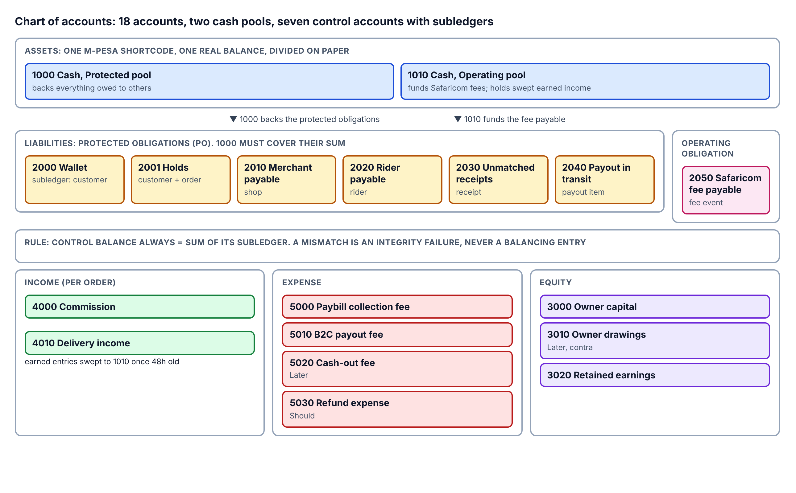
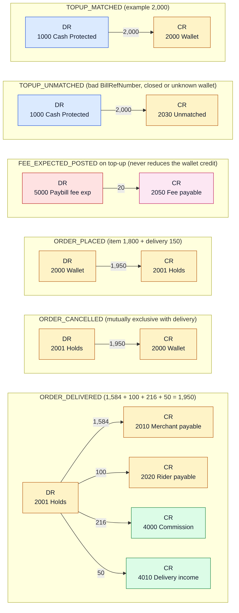
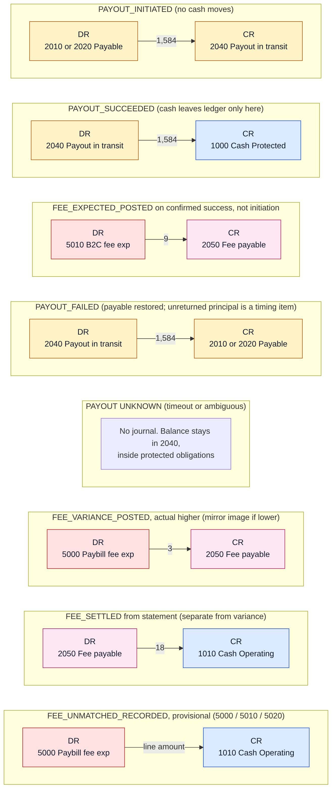
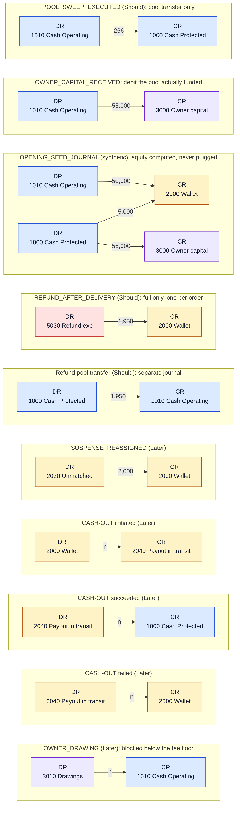

# 02. Chart of accounts

*Draft 0.1. The accounts are also stored as a data file that seeds the database; a test must assert every account named in [03](03-events-and-posting.md) exists here.*

## 1. The map

Colour key: blue cash, amber protected obligations, pink operating obligation, purple equity, green income, red expense. The subledger key sits under each control account.

## 2. Account reference (lookup table)

| Code | Account | Type | Normal side | Subledger key | Pool |
|---|---|---|---|---|---|
| 1000 | Cash, Protected Pool | Asset | Debit | none | Protected |
| 1010 | Cash, Operating Pool | Asset | Debit | none | Operating |
| 2000 | Customer Wallet Liability | Liability | Credit | customer | Protected obligation |
| 2001 | Customer Holds Liability | Liability | Credit | customer + order | Protected obligation |
| 2010 | Merchant Payable | Liability | Credit | shop | Protected obligation |
| 2020 | Rider Payable | Liability | Credit | rider | Protected obligation |
| 2030 | Unmatched Receipt Liability | Liability | Credit | receipt | Protected obligation |
| 2040 | Payout-in-Transit Liability | Liability | Credit | payout item | Protected obligation |
| 2050 | Safaricom Fee Payable | Liability | Credit | fee event | Operating obligation |
| 3000 | Owner Capital | Equity | Credit | none | |
| 3010 | Owner Drawings | Contra-equity | Debit | none | |
| 3020 | Retained Earnings | Equity | Credit | none | |
| 4000 | Commission Income | Income | Credit | order | |
| 4010 | Delivery Income | Income | Credit | order | |
| 5000 | Paybill Collection Fee Expense | Expense | Debit | none | |
| 5010 | B2C Payout Fee Expense | Expense | Debit | none | |
| 5020 | Cash-out Fee Expense | Expense | Debit | none | |
| 5030 | Refund Expense | Expense | Debit | order + refund | |

**Deliberately absent:** a suspense account for arbitrary differences (unexplained differences are reconciliation exceptions, never plugged); a "Payout Recoverable" asset (cash leaves the ledger only on confirmed payout success; an unreturned principal is a timing item); an opening-balance clearing account (opening equity is computed and split into Owner Capital and Retained Earnings); per-customer, per-shop or per-rider GL accounts (subledgers do that job); an unclaimed customer funds liability (deferred with the dormancy and day-90 write-off workflow).

## 3. The two cash accounts are logical pools

There is one M-Pesa shortcode, so one real balance. Accounts 1000 and 1010 divide it on paper:

- **Protected (1000)** backs everything owed to others: wallets, holds, payables, unmatched receipts and payouts in transit.
- **Operating (1010)** funds Safaricom fees and holds earned income that has been swept.

This is an accounting control, not a legal separation. See [07](07-reconciliation.md) for the coverage check.

## 4. Control accounts and subledgers

Rules: a control account balance **always equals** the sum of its subledger balances. A mismatch is an integrity failure, never an invitation to post a balancing entry. A customer's total obligation is `available (2000) + held (2001)`.

## 5. How accounts move: one journal card per event

Read each card as: the debited account points to the credited account(s) with the amount. Amounts are the worked examples from [03](03-events-and-posting.md).

### Collections and orders

### Payouts and fees

### Pools, equity, refunds and Later flows

