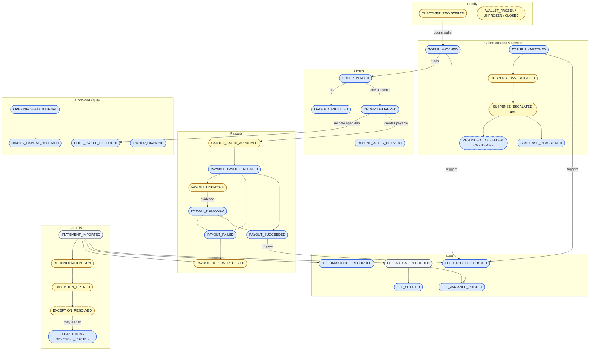

# 03. Events and posting rules

*Draft 0.1. Account codes refer to [02](02-chart-of-accounts.md). Amounts are whole KES. Fee and tariff values are loaded from a versioned tariff table; the figures below are worked examples from the tariff form in `docs/discovery/` and must be re-checked against it.*

## 1. How events are treated

| Treatment | Rule |
|---|---|
| **Journal event** | A verified occurrence creates, transfers, settles or reverses a balance or obligation. It posts balanced lines and updates subledgers in the same database transaction. |
| **Status event** | A workflow or control state changes and no balance changes. Record it; do not invent a journal. |
| **Evidence event** | A callback, file, request or observation is stored. It may enable a later status change or journal. |

Priority: **Must** is required for submission; **Should** only if the core is stable; **Later** is deferred but the contract is fixed here so a future build cannot contradict it.

## 2. Event map

Blue = journal event, yellow = status event, grey = evidence. Dashed border = Should (or Later where dotted). Account-level view of each journal: [02 section 5](02-chart-of-accounts.md).

### Event catalogue (reference table)

| Event | Source | Treatment | Priority |
|---|---|---|---|
| CUSTOMER_REGISTERED | Registration process | Status (opens wallet, no journal) | Must |
| WALLET_FROZEN / UNFROZEN / CLOSED | Faith or Grace freeze; Grace unfreezes and closes | Status | Later |
| TOPUP_MATCHED | M-Pesa C2B confirmation | Journal | Must |
| TOPUP_UNMATCHED | M-Pesa C2B confirmation | Journal | Must |
| SUSPENSE_INVESTIGATED | Human (Faith) | Evidence/status | Must |
| SUSPENSE_ESCALATED | Ageing job (48 hours) | Status | Should |
| SUSPENSE_REASSIGNED | Peter prepares, Grace approves | Journal | Later |
| SUSPENSE_REFUNDED_TO_SENDER, day-30/day-90 steps, write-off | Human | Journal/status | Later |
| FEE_EXPECTED_POSTED | Triggering top-up or confirmed payout success | Journal | Must |
| FEE_ACTUAL_RECORDED | Statement import | Evidence | Must |
| FEE_VARIANCE_POSTED | Reconciliation | Journal | Must |
| FEE_SETTLED | Statement import | Journal | Must |
| FEE_UNMATCHED_RECORDED | Statement import | Journal (provisional) | Must |
| ORDER_PLACED | Order system | Journal | Must |
| ORDER_DELIVERED | Order system (must carry `rider_id`) | Journal | Must |
| ORDER_CANCELLED | Order system | Journal | Must |
| REFUND_AFTER_DELIVERY (+ pool transfer) | Human, approved | Journal | Should |
| PAYOUT_BATCH_APPROVED | Human (maker-checker) | Status | Must |
| PAYABLE_PAYOUT_INITIATED | Worker (via outbox) | Journal | Must |
| PAYABLE_PAYOUT_SUCCEEDED | M-Pesa result | Journal | Must |
| PAYABLE_PAYOUT_FAILED | M-Pesa result | Journal | Must |
| PAYABLE_PAYOUT_UNKNOWN | Timeout or ambiguous response | Status | Must |
| PAYABLE_PAYOUT_RESOLVED | Independent evidence | Journal (success or failure treatment) | Must |
| PAYOUT_RETURN_RECEIVED | Statement | Status (clears a timing item) | Must |
| CASHOUT_* (requested, approved, initiated, succeeded, failed, unknown, resolved) | Customer, Grace, M-Pesa | Mixed | Later |
| POOL_SWEEP_EXECUTED | Authorised human, manual command | Journal | Should |
| OWNER_CAPITAL_RECEIVED | Owner | Journal | Must |
| OWNER_DRAWING_POSTED | Owner | Journal | Later |
| OPENING_SEED_JOURNAL_POSTED | Operator | Journal | Must |
| STATEMENT_IMPORTED | Finance user | Evidence | Must |
| RECONCILIATION_RUN | Daily 06:00 EAT job or manual | Status (no journal) | Must |
| RECONCILIATION_EXCEPTION_OPENED | Reconciliation | Status | Must |
| RECONCILIATION_EXCEPTION_RESOLVED | Human with evidence | Status (may lead to a correction) | Should |
| CORRECTION_POSTED / REVERSAL_POSTED | Authorised human | Journal | Must |
| LATE_EVENT handling | System | Rule (see section 7) | Must (post-close path Should) |
| MONTH_CLOSED, DORMANCY_FLAGGED | Human, job | Status | Should / Later |

Pre-delivery refunds are not separate events: a cancellation releases the hold. Partial refunds are not supported in v1.

**Evidence-only records** (stable ID, source, timestamp, linked to any financial event): callback received or rejected, duplicate callback, conflicting receipt evidence, Daraja request timed out, status query attempted and answered, notification queued or sent, job started or failed, malformed statement rejected, approval requested or granted, evidence attached.

## 3. Posting rules

All amounts positive integers. "Dr" = debit, "Cr" = credit.

### 3.1 Top-up (matched)
Example: KES 2,000 top-up, expected Paybill fee KES 20.

| Journal | Dr | Cr | Amount |
|---|---|---|---|
| Collection | 1000 | 2000 | 2,000 |
| Expected fee | 5000 | 2050 | 20 |

The fee never reduces the wallet credit. If unmatched, credit **2030** instead of 2000; the expected fee still posts. A matched top-up to a frozen wallet is credited but restricted.

### 3.2 Orders
Example: item KES 1,800, delivery KES 150, hold KES 1,950. Commission = 216, merchant = 1,584, rider = 100, delivery income = 50.

| Event | Dr | Cr | Amount |
|---|---|---|---|
| Placed | 2000 | 2001 | 1,950 |
| Cancelled | 2001 | 2000 | 1,950 |
| Delivered | 2001 | 2010 / 2020 / 4000 / 4010 | 1,950 = 1,584 + 100 + 216 + 50 |

Cancellation and delivery are mutually exclusive outcomes of one hold. A duplicate event never posts twice. Delivery before placement, or without `rider_id`, is rejected with a retryable error and no journal.

### 3.3 Payouts (merchant or rider)
Example: merchant payable KES 1,584, expected B2C fee KES 9.

| Step | Dr | Cr | Amount |
|---|---|---|---|
| Initiated | 2010 (or 2020) | 2040 | 1,584 |
| Succeeded | 2040 | 1000 | 1,584 |
| Expected fee (**posted on confirmed success, not on initiation**) | 5010 | 2050 | 9 |
| Failed | 2040 | 2010 (or 2020) | 1,584 |
| UNKNOWN | no journal | | stays in 2040 |

After a confirmed failure, an unreturned principal is a timing item, not cash ([07](07-reconciliation.md)). The restored payable may enter a later batch as a **new** payout item, only after the principal is confirmed returned. An item that is PENDING or UNKNOWN is never initiated again.

### 3.4 Fees
Expected fee 15, actual 18 (example):

| Step | Dr | Cr | Amount |
|---|---|---|---|
| Expected posted | 5000 | 2050 | 15 |
| Variance (actual higher) | 5000 | 2050 | 3 |
| Variance (actual lower) | 2050 | 5000 | difference |
| Settled from statement | 2050 | 1010 | 18 |
| Unmatched statement fee (provisional) | 5000 / 5010 / 5020 | 1010 | line amount |

Variance and settlement are separate events. Importing a statement line never posts a second expense. The final expense and payable equal the actual statement fee.

### 3.5 Pool and equity events

| Event | Dr | Cr | Rule |
|---|---|---|---|
| Weekly sweep | 1010 | 1000 | Only earned income entries at least 48 hours old, limited to protected surplus (see [07](07-reconciliation.md)) |
| Owner capital | 1010 (or 1000) | 3000 | Debit the pool actually funded |
| Seed / opening | 1000, 1010 | 2000, 3000, 3020 | Equity is computed (assets minus liabilities), never plugged; labelled synthetic |
| Refund after delivery (Should) | 5030 | 2000 | Full refund only, one per order; business-funded from operating |
| Refund pool transfer (Should) | 1000 | 1010 | Same amount, separate journal |
| Reassignment (Later) | 2030 | 2000 | Cash unchanged; a receipt is reassigned once |

### 3.6 Cash-out (Later; contract only)
Initiated: Dr 2000 / Cr 2040. Succeeded: Dr 2040 / Cr 1000. Failed: Dr 2040 / Cr 2000. UNKNOWN: no journal.

## 4. Order snapshot (stored at placement, immutable)

`order_id`, `customer_id`, `merchant_id`, `placed_at`, `item_value`, `delivery_fee`, `commission_rate_bps`, `commission_policy_version`, `hold_amount` (= item value + delivery fee), `source_event_id`. The rider is supplied by the delivery event. Commission and allocation are computed by the ledger at delivery from the snapshot; an upstream-supplied commission is never trusted. Uniqueness: `(order_id, event_type)` plus the upstream event ID.

## 5. Approvals

One minimal rule, not a workflow engine: a manual posting needs an approver who is not its creator, enforced server-side from the API key's role.

| Amount | Who |
|---|---|
| Up to KES 500 | Faith alone; appears on Grace's daily exception list |
| KES 501 to 5,000 | Faith prepares, Grace approves |
| Above KES 5,000 | Grace prepares, owner approves |

Applies to post-delivery refunds (evidence: delivered order ID and a reason code), corrections and reassignments (Peter prepares, Grace approves; Faith cannot post). For corrections the threshold applies to the **gross amount of the reversal journal**. Every manual credit that represents money received needs a real M-Pesa receipt reference.

## 6. Corrections

A correction is two new journals: a **reversal** (exact mirror of every original line) and a **replacement** (the correct event). Original, reversal and replacement each have their own journal ID. Fields: `reverses_journal_id`, `corrects_journal_id`, `follows_reversal_journal_id`, `correction_id`, plus creator, approver, reason code, evidence and idempotency key.

Example: commission posted as 200 instead of 216 on a 1,800 order. Reverse (Dr 2010 1,600; Dr 2020 100; Dr 4000 200; Dr 4010 50; Cr 2001 1,950), then re-post the correct delivery (merchant 1,584, commission 216).

**v1 limit:** a correction is **blocked** when any part of the affected payable is already paid or in transit, because reversing it would make the payable negative. Such a case stays an open reconciliation exception, handled outside the system and documented.

Never allowed: editing or deleting a journal; reversing only some lines; reusing a journal ID; an unexplained balancing entry; approving your own correction; reversing a valid payout because its callback was late. A ledger reversal does not reverse a real M-Pesa transaction.

## 7. Business dates and late events

| Event | Event time | Business date |
|---|---|---|
| Top-up (matched or not) | M-Pesa transaction time | its EAT date |
| Order placed / cancelled | Upstream event time | its EAT date |
| Order delivered | Upstream delivery time | its EAT date (**revenue date**) |
| Payout initiated | Daraja submission time | its EAT date |
| Payout succeeded or failed | Confirmed M-Pesa result time | its EAT date |
| Expected fee | Triggering event's time | triggering event's business date |
| Statement line | Line's own timestamp | line's EAT date, not the import date |

A late event is validated and de-duplicated by its original source ID, keeps its original event time, and is posted with that effective date while its period is open. If it arrives after a daily reconciliation, that run is re-run and the earlier run is marked superseded, not edited. After a month close (not built in v1), it posts in the current open period linked to the original.

## 8. Golden scenario (first end-to-end test)

Seed: protected 10,000, operating 50,000, wallet 5,000, owner capital 55,000. Fees from the tariff: 20 on a 2,000 top-up, 9 on a 1,584 payout. Assert exact journal lines, not just balances.

| Step | Event | Protected cash | Operating cash | Protected obligations | Total debits so far |
|---|---|---|---|---|---|
| 0 | Seed | 10,000 | 50,000 | 5,000 | 60,000 |
| 1 | Top-up 2,000 + expected fee 20 | 12,000 | 50,000 | 7,000 | 62,020 |
| 2 | Order hold 1,950 | 12,000 | 50,000 | 7,000 | 63,970 |
| 3 | Delivery | 12,000 | 50,000 | 6,734 | 65,920 |
| 4 | Payout initiated 1,584 | 12,000 | 50,000 | 6,734 | 67,504 |
| 5 | Payout succeeded + expected fee 9 | 10,416 | 50,000 | 5,150 | 69,097 |
| 6 | Fees settled (29) | 10,416 | 49,971 | 5,150 | 69,126 |
| 7 | Sweep 266 (aged income) | 10,150 | 50,237 | 5,150 | 69,392 |
| 8 | Refund 1,950 + pool transfer | 12,100 | 48,287 | 7,100 | 73,292 |

Protected obligations = wallet + holds + merchant + rider + unmatched receipts + payouts in transit. Rider payable stays at 100 throughout. Step 8 is a Should path.
