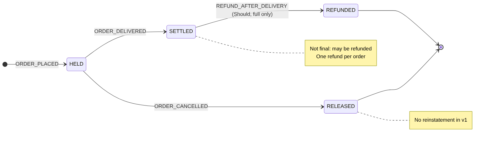
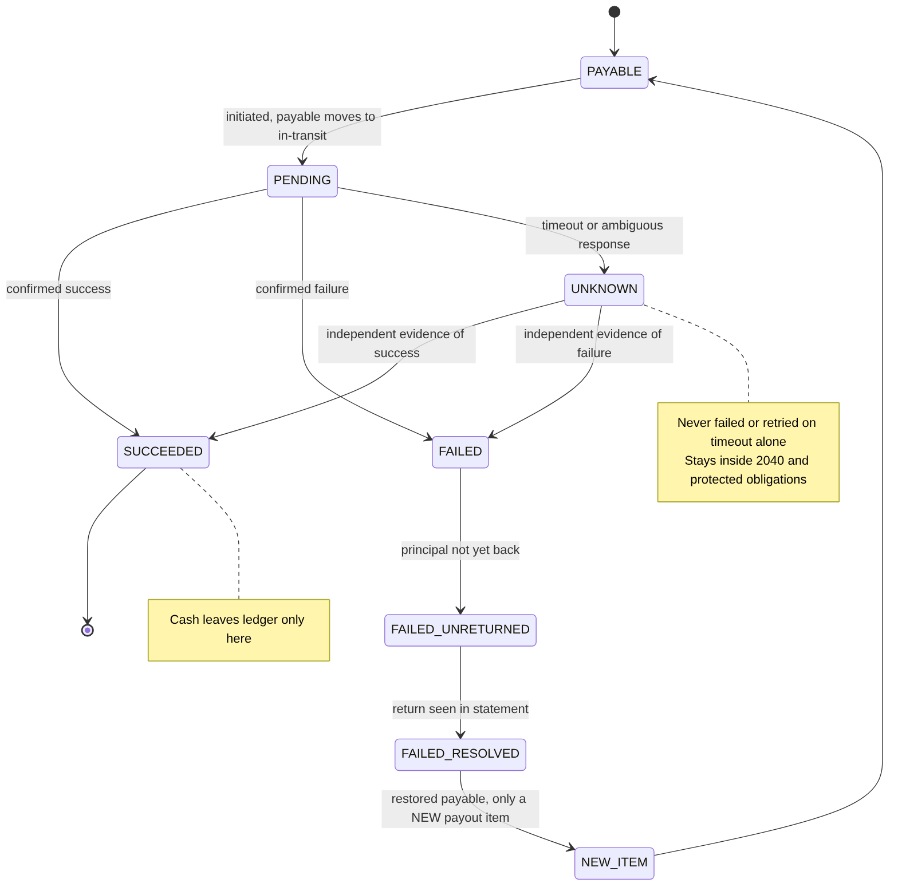
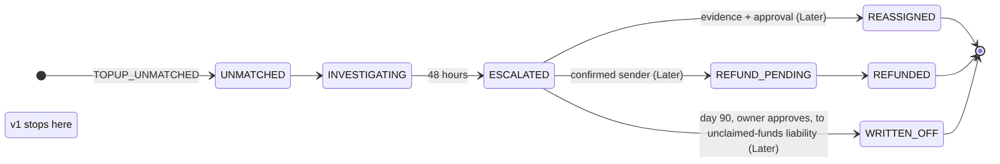
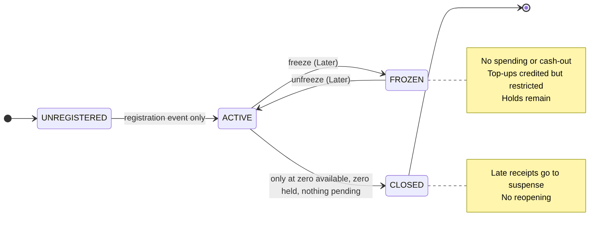
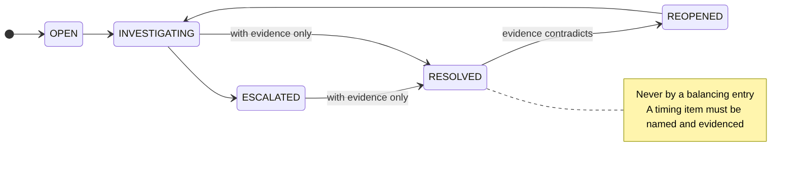
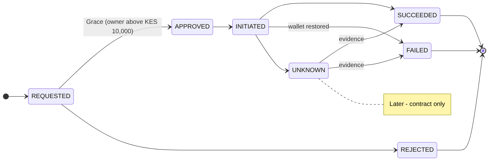

# 04. State machines

*Draft 0.1. A transition not listed is forbidden. Repeated events never post twice. Diagram sources: `docs/diagrams/src/`.*

## Order (financial state)

Forbidden: delivery before placement; RELEASED to SETTLED (a reinstatement event would have to be designed); SETTLED to RELEASED; REFUNDED to SETTLED.

## Payout item (merchant or rider)

Forbidden: UNKNOWN to success or failure on a timeout alone; SUCCEEDED to FAILED by a normal callback; a second initiation of an item that is PENDING or UNKNOWN. A late initiation response never overwrites a state a callback already established. The restored payable is paid only by a **new** payout item, after the principal is confirmed returned.

## Unmatched receipt

v1 builds UNMATCHED, INVESTIGATING and ESCALATED; the dispositions are Later.
Forbidden: reassignment without evidence and approval; refund without a confirmed sender; any disposition that removes the liability without a journal; write-off to income.

## Wallet

Forbidden: a payment creating or reactivating a wallet. Freeze, unfreeze and close are Later.

## Reconciliation exception

Forbidden: resolving with no evidence; resolving by posting a balancing entry; calling a difference a timing item without naming and evidencing it.

## Cash-out (Later; contract only)

Rejected requests cannot be initiated; UNKNOWN is never treated as failed without evidence.
