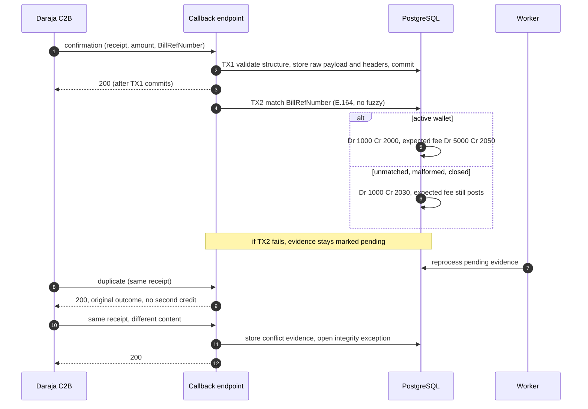
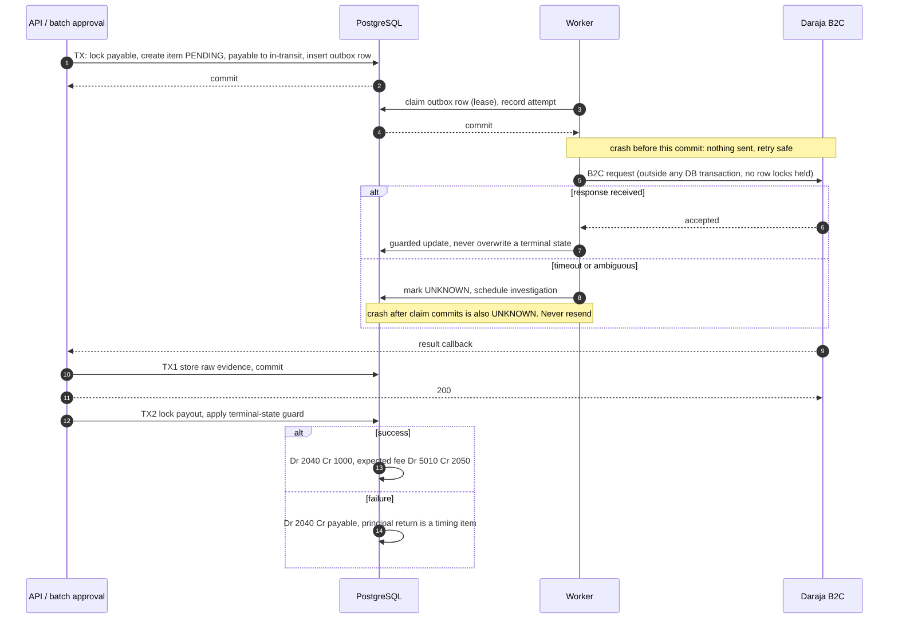

# 06. Concurrency and idempotency

*Draft 0.1. Daraja behaviour marked UNVERIFIED must be settled by the sandbox spike and recorded in `docs/engineering/daraja-notes.md`.*

## 1. Idempotency

Every entry point records: a unique key scoped to source and operation, a canonical payload hash, the processing status, the resulting journal or resource reference, and the first and later receipt times. **Same key with different content is a conflict, never a new financial event.**

| Entry point | Unique key | Identical duplicate | Same key, different content |
|---|---|---|---|
| C2B confirmation | M-Pesa receipt number | 200, original outcome, no second credit | Persist conflict evidence, acknowledge 200, leave the original credit untouched, open an integrity exception |
| B2C result | Payout item plus provider conversation identifiers; **terminal-state guard on the payout is primary**, payload hash is evidence only | 200, no second transition | Preserve both pieces of evidence; reject reuse of the event identity |
| B2C queue timeout (UNVERIFIED) | `(payout_id, timeout_stage)` | Existing result | Reject conflicting reuse |
| Order events | upstream `source_event_id` and `(order_id, event_type)` | Return the existing result | 409, conflict evidence preserved |
| Manual postings and corrections | Client-generated UUID, scoped to actor and operation | Return the original result | 409, no posting |
| Statement import | Account, period and file identity (content hash as evidence) | Return the existing import | Import conflict |
| Scheduled jobs | `(job_name, business_date, run_type)` | Return the existing run | Needs an explicitly new run identity |

A manual posting with a new key is not automatically a duplicate: where an operation has a unique business identity (an order, a receipt), a constraint on that identity prevents the duplicate effect.

### HTTP behaviour

| Situation | Response |
|---|---|
| Valid callback or event durably recorded | 200 (Daraja callbacks); 202 (asynchronous work) |
| Identical duplicate | 200 with the original outcome |
| Same identity, different content, authenticated API | 409 |
| Same identity, different content, Daraja callback | Record the evidence, then 200 (an error only triggers pointless retries) |
| Invalid request | 400 |
| Unauthenticated or unauthorised | 401 / 403 |
| Temporary failure before durable acceptance | 5xx so the caller may retry |

## 2. Callback handling: evidence first

1. **Transaction 1:** validate the structure, store the raw payload, headers, receive time and provider identifiers, and commit.
2. **Transaction 2:** match and post (for C2B: credit the wallet or post to suspense). If this fails, the evidence stays and is marked pending processing.
3. Return 200 once transaction 1 has committed. The worker reprocesses anything left pending.

A lost callback is the worst outcome, so nothing is acknowledged before it is durable.

## 3. Locking

Postings lock rows in this global order, skipping any a transaction does not need, and sorting IDs where several of one kind are locked:

1. Batch or job-control row
2. Order
3. Customer wallet
4. Order hold
5. Payout item
6. Merchant or rider payable (sorted by party ID)
7. Pool cash and control projection rows (sorted by account ID)

PostgreSQL deadlock detection is a safety net, not the strategy. At roughly 100 postings a day, contention on hot rows is not a concern; do not optimise it.

| Resource | Strategy | One transaction contains |
|---|---|---|
| Customer wallet | `SELECT ... FOR UPDATE`, check funds after the lock | Check, journal, hold and projection update |
| Order and hold | Lock both, enforce the state transition | Transition and journal |
| Payable | Lock before reserving or restoring | Reservation and payable change |
| Payout item | Lock before handling a callback, timeout or resolution | Evidence, state change and journal |
| Sweep (Should) | Advisory lock or a locked control row; lock eligible income in stable order | Eligibility, coverage, transfer and run record |
| Reconciliation run | Unique run identity and a date-scoped advisory lock | Run record and findings |

## 4. Payouts and the Daraja call (outbox)

1. In one transaction: lock the payable, create the payout item as PENDING (payable moves to in-transit), insert an outbox request. Commit.
2. The worker claims the outbox row (a lease) and records an attempt. Commit.
3. The worker calls Daraja **outside** any database transaction and holds no row locks across the call.
4. It records the response with a guarded update that never overwrites a terminal state already set by a callback.
5. On timeout or an ambiguous response, mark UNKNOWN and schedule investigation. **Never** resend automatically.

### Crash points

| Crash happens | Result |
|---|---|
| Before the claim and attempt commit | Nothing was sent; the outbox row is retried |
| After the claim and attempt commit, before the response is recorded | Cannot tell whether it was sent: the payout is **UNKNOWN**; resolve with independent evidence, never resend |

### Race: result arrives while initiation is in progress

The payout item and its PENDING state are committed before any network call, so the callback always finds a payout to lock. If it still cannot be correlated, keep it as evidence and retry internally; never discard it.

A scheduled job moves overdue PENDING payouts to UNKNOWN. A statement import or an independently verified provider result may resolve UNKNOWN.

## 5. UNVERIFIED Daraja behaviour

| Question | Settled by |
|---|---|
| Is `OriginatorConversationID` caller-supplied, and can it be reused? | B2C spike |
| Safaricom's duplicate window (third-party sources say 60 seconds, code 2033) | B2C spike |
| What a queue timeout looks like, and the callback ordering | B2C spike |
| Can an UNKNOWN payout be queried without an M-Pesa receipt? | B2C spike |
| Callback authenticity mechanism | Official docs and spike; do not invent a signature scheme |
| Whether a failed payout is charged a fee | Statement or documented as unknown |
