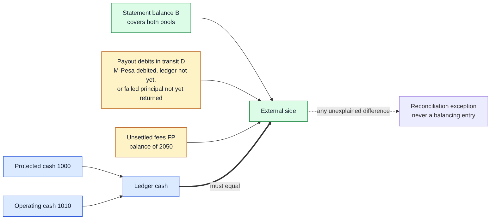
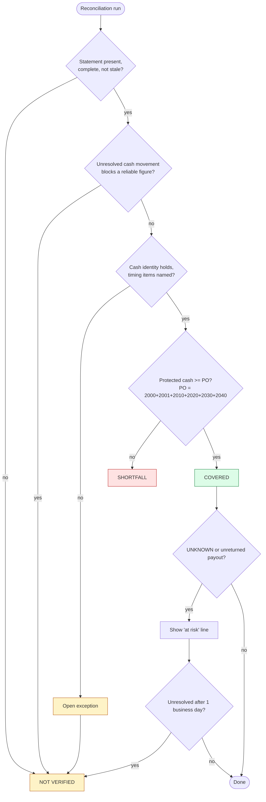

# 07. Reconciliation and coverage

*Draft 0.1. Reconciliation compares the ledger with independent evidence and reports differences. It never posts a balancing entry.*

## 1. Schedule and inputs

- Daily at **06:00 EAT** for the previous business day, plus pre-payout checks on **Sunday and Thursday evenings** before the Monday and Friday batches.
- Inputs: the M-Pesa statement (CSV import), stored callback evidence, and posted ledger entries.
- A run is identified by `(account, business_date, run_id)`. A re-run (for example after a late event) **supersedes** the earlier run and keeps it as audit history.
- If the required statement has not arrived or is incomplete, the run reports **NOT VERIFIED**. It never reports a zero-difference success.

## 2. Line-by-line matching

Match each statement line to ledger and callback records: top-ups to receipts, payouts to payout items, fee lines to fee events. Each unmatched or mismatched item becomes an exception with a fingerprint.

| Finding | Typical cause | Handling |
|---|---|---|
| Statement credit with no ledger receipt | Lost callback | Exception; resolved with evidence, never auto-posted |
| Ledger receipt with no statement credit | Timing, or fabricated receipt | Exception |
| Amount mismatch | Wrong amount recorded | Exception |
| Duplicate statement line | File error | Exception |
| Payout debit with no payout item | Unknown outgoing payment | Exception |
| Fee line with no triggering event | Unmatched fee | Provisional fee expense (Dr fee expense, Cr 1010) plus exception |
| Fee amount differs from expectation | Tariff variance | Variance journal ([03](03-events-and-posting.md)) |

An exception moves OPEN → INVESTIGATING → ESCALATED → RESOLVED only with evidence. Treating a difference as a timing item requires naming and evidencing it.

## 3. Cash identity



Account 1000 and 1010 together are ledger cash. The statement balance covers **both pools**.

```
Protected cash + Operating cash = Statement balance + Payout debits in transit + Unsettled fees
```

| Term | Meaning |
|---|---|
| Statement balance (B) | M-Pesa balance from the latest complete statement |
| Payout debits in transit (D) | M-Pesa has debited a payout (or a failed payout's principal has not yet returned) but the ledger has not yet recorded cash leaving or returning |
| Unsettled fees (FP) | Balance of 2050: fees posted at the expected tariff and not yet settled from the statement |

A difference not explained by these named items is an exception. Money in the statement but absent from the ledger is an exception, not a timing item.

## 4. Protected coverage



```
Protected obligations (PO) = Wallet (2000) + Holds (2001) + Merchant (2010) + Rider (2020)
                           + Unmatched receipts (2030) + Payouts in transit (2040)
Protected surplus = Protected cash (1000) - PO
```

| Status | Condition |
|---|---|
| **COVERED** | Evidence complete and reconciled, identified timing items accounted for, protected cash ≥ PO |
| **SHORTFALL** | Complete evidence shows protected cash < PO |
| **NOT VERIFIED** | Statement stale, incomplete or missing, or an unresolved cash movement prevents a reliable figure |

A payout in transit stays inside PO for its whole life (PENDING, UNKNOWN, or failed-but-unreturned), so a healthy payout batch never looks like a deficit. Operating cash is never counted towards protected coverage. Unswept earned income sits inside protected cash, so the surplus normally equals unswept income plus any deliberate cushion.

An UNKNOWN or unreturned payout is shown as COVERED with a separate "at risk" line, and escalates to NOT VERIFIED if unresolved after one business day (a working assumption).

## 5. Sweep (Should) and the fee floor

- **Eligible income:** earned commission and delivery income entries at least **48 hours old** by delivery event time, not yet swept. Selected per entry, not per calendar day.
- **Maximum sweep** = the smaller of eligible income and `max(0, protected surplus)`.
- **Fee floor:** KES 13,000, roughly two weeks of expected fees. `Operating cash - unsettled fee payable` must stay at or above it before any owner drawing or discretionary outflow. A sweep is an inflow and cannot breach the floor. A post-delivery refund funded from operating is never blocked but raises an alert.
- **Opening float:** KES 50,000 owner capital, a stated assumption.

## 6. The sandbox limitation and the fixture builder

The Daraja sandbox does not provide a complete, independent statement. The reconciliation engine is therefore tested against a **statement fixture** produced by a small tool that:

- generates a CSV in an assumed portal format from the ledger and callback records,
- can drop, duplicate or alter lines and add an unknown credit, debit or fee, and
- labels every file as synthetic.

A fixture proves the engine detects mismatches. It does not prove a real cash balance, and the write-up must say so. The assumed column layout is documented next to the parser.

## 7. What reconciliation never does

Post a balancing entry; credit a difference to income; rewrite a journal; report success when evidence is missing; resolve an exception without evidence.
